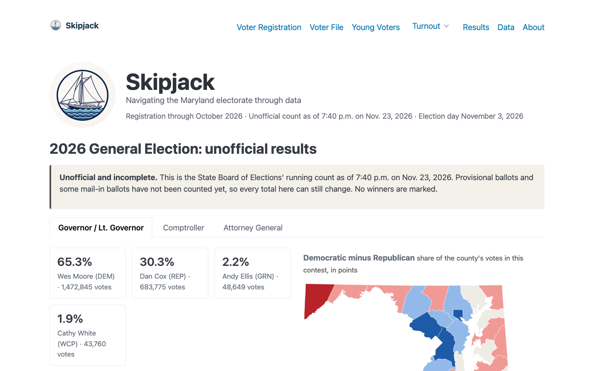
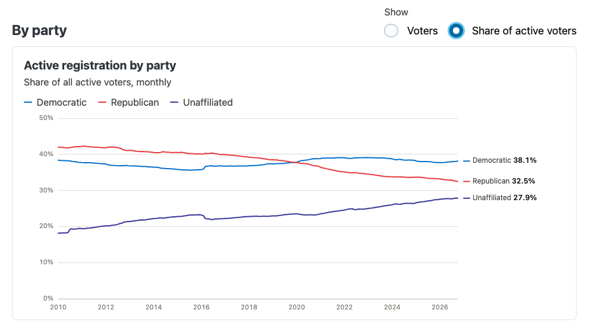
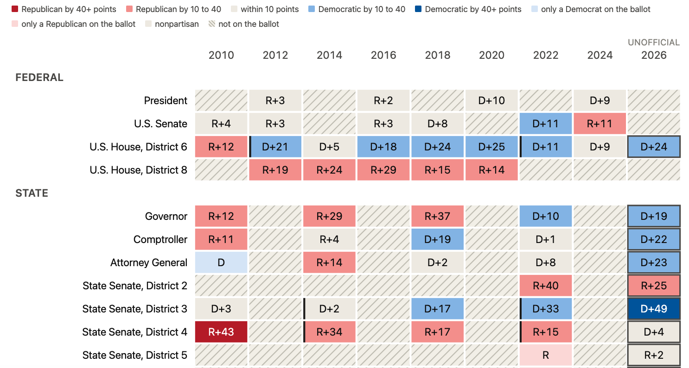
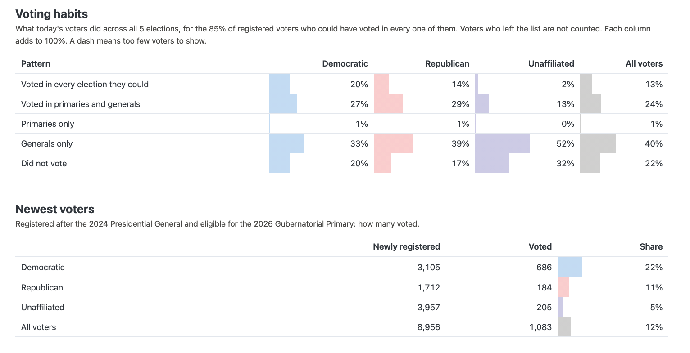
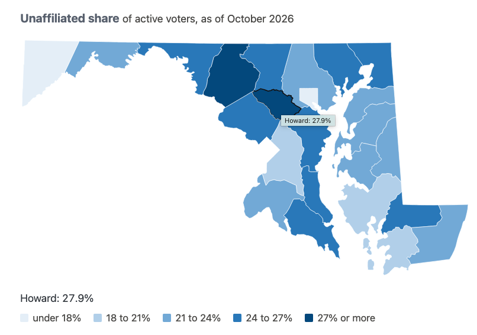
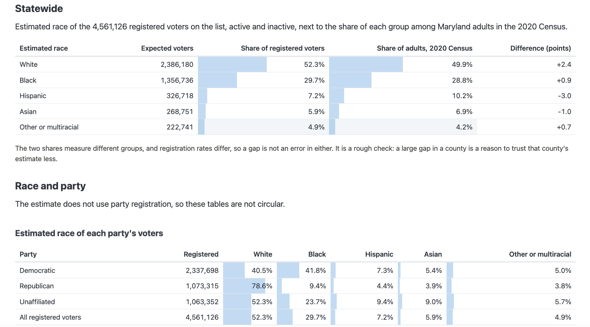
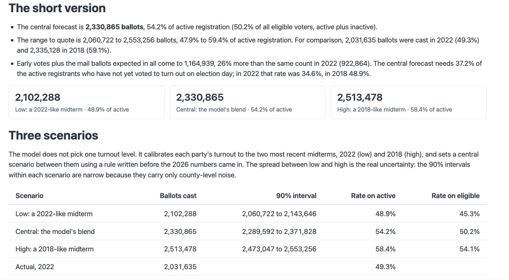

A lot of people have the wrong idea about Maryland elections.

Because Democrats dominate statewide contests and hold a supermajority in the state legislature, they figure that politics here aren’t interesting. I have a tough time making the case to students that they’ll find excellent stories in Maryland elections.

But the stories are there if you know where to look, especially if you use the variety of data offered by the [State Board of Elections](https://elections.maryland.gov/).

For example, Maryland Republicans are at something of a tipping point. According to the monthly voter registration summaries that the SBOE posts, there are fewer than 2,000 registered voters separating the GOP from those who have chosen no party affiliation, a gap that has been narrowing over time. Being the third choice of voters is never good news for a party; even conservative states such as Wyoming and South Dakota have more registered Democrats than any other non-Republican affiliation.

Or consider Frederick County, which has seen dramatic shifts in its voting behavior. Since 2010, the county has shifted 31 points towards Democrats at the top of the ticket. One county council district went from a D+9 result in 2014 to D+45 twelve years later.

Perhaps most interesting to me is that the state’s incumbent Democratic Governor, Wes Moore, garnered fewer votes than two other statewide candidates this year in half of the state’s jurisdictions (23 counties plus Baltimore City). That margin includes two liberal candidates that also ran for governor on minor party lines.

The hard part in finding all of these is partly imagination and partly logistical. The data that provides those insights is split among multiple PDFs, spreadsheets and HTML files on the SBOE site. Data on turnout, early and mail voting, plus same-day registration, can be found in reports under each election, published in the site's "[Press Room](https://elections.maryland.gov/press_room/index.html)". Voter registration statistics, [including monthly reports](https://elections.maryland.gov/voter_registration/stats.html), are found in PDFs in a different section. And results are in another place.

## Everything in One Place

But you can't really get the full picture of the Maryland electorate's behavior unless you have all of those - and more - in one place. That's why I built [Skipjack](https://newsappsumd.github.io/skipjack/), a site for helping me understand Maryland voters and their choices. Skipjack collects the separate pieces and ties them together, mostly through geography and time.

Time is Skipjack's first organizing principle. When there's an election - like the one we just had this month - early voting before election day is the first thing on the homepage. After the election it's results, unofficial and then official. In between, voter registration patterns are the main thing. Skipjack has [results](https://newsappsumd.github.io/skipjack/results/) dating back to 2010, and a wide range of information about the results. For the [2026 general](https://newsappsumd.github.io/skipjack/results/gg26/), for example, you can find results by contest and county, plus details on [incumbents](https://newsappsumd.github.io/skipjack/results/gg26/#incumbents) running for re-election, thanks to information from the [Maryland Manual](https://msa.maryland.gov/msa/mdmanual/html/mmtoc.html). County results pages provide a listing of results from all contests in that county (here's [Charles](https://newsappsumd.github.io/skipjack/results/gg26/county/charles/)).

## Going Deep on a County

Let's say you find something you want to dig into, or a question you want to answer. How has Frederick County changed since 2010? Each county has its own snapshot that describes voter registration, provides context from the state's voter file and shows how election results have moved during the past 16 years.

Frederick's electorate, by Maryland standards, is weird. It's roughly split between Democrats, Republicans and unaffiliated voters, ranging from 28% to 38% in terms of share.

That's made Frederick one of the swingiest counties in the state this century, although mostly that swing has been towards Democrats. Once a reliably GOP place, Frederick County has swung 31 points to the left since 2010 and the margin for the governor's race this year is 19 points. You can see the change over time in electoral margins by office during that period: although Donald Trump won the county by two points in 2016, Kamala Harris won it by nine in 2024. The shift is more pronounced in some state races. Larry Hogan won the county by 37 points during his 2018 gubernatorial re-election. Wes Moore has won it twice, by double-digits. County council districts that were highly competitive in 2014 are now solidly Democratic.

Skipjack provides additional context from the Maryland voter file, which lists each voter and their recent history. Because the voter file has to be purchased separately, has individual information and is relatively large, Skipjack does not reproduce it in whole; instead it provides aggregates from it to shed light on electoral participation. The voter file that the site currently uses is from late summer 2026, so it doesn't have every voter from the 2026 general election, but it has most of them. One of the things you can see is [how many dedicated voters each county has](https://newsappsumd.github.io/skipjack/voters/file/county/frederick/) - the folks who vote in every election.

Having the voter file also makes it possible to break down the electorate by age and gender. My plan is to get and update the voter file at least twice a year, and probably more often during election years.

## Who the Voters Are

For a more macro view of the electorate, the state produces monthly voter registration totals, including new registrations. That makes it easier to see the partisan composition of the state and how that is changing. Skipjack parses each PDF and makes a map of it, so that you can see [November 2012](https://newsappsumd.github.io/skipjack/voters/month/2012-11/), for example, and then [October 2026](https://newsappsumd.github.io/skipjack/voters/month/2026-10/).

One of the trends in Maryland (and elsewhere) is the increase in unaffiliated voters, which has some real consequences for a state with closed primary elections. There are multiple counties where the percentage of voters not tied to the Republican or Democratic parties is at or above one-quarter of the electorate. In Howard and Frederick that share is nearly 28%, and although the baseline is low, about one in seven voters in [heavily Democratic Prince George's County](https://newsappsumd.github.io/skipjack/voters/county/prince-georges/) is unaffiliated, a dramatic increase in the past 16 years.

Maryland's voter file doesn't have information about a voter's race, but like many states Black voters play a crucial role in elections. There are risks to estimating the race/ethnicity of a voter based on limited information, but it's something that campaigns and political scientists do, so Skipjack does it as well. To do so, it uses the [wru R package](https://github.com/kosukeimai/wru), which produces probabilistic predictions of each voter's race based on their name, zip code and Census data. Skipjack _never_ shows this prediction for individual voters; it only has [estimates for all voters and within each jurisdiction](https://newsappsumd.github.io/skipjack/voters/race/), alongside Census information about those demographics.

I'm more confident in Skipjack's estimates for counties that are predominantly one race or another, and less so for those jurisdictions that are more diverse, but in general these estimates seem pretty solid to me. They show that younger voters are more likely to be Hispanic or multi-racial than their older counterparts, with clusters of Hispanic voters in Montgomery and Prince George's counties and Asian voters in Montgomery and Howard counties.

## Predicting Turnout

One of my goals in building Skipjack was to use the information that it collects to build a turnout model for the state and each jurisdiction. My assumptions going into this election were that turnout would probably fall between the 2018 and 2022 elections, although the gubernatorial election was not competitive and there was no U.S. Senate race on the ballot in Maryland this year. That limited the polling available in Maryland, so it didn't play a big role in building the model. [The model](https://newsappsumd.github.io/skipjack/turnout/forecast/), fit in R, is a regression of ballots cast over active registration by county and party in six elections: the 2018 and 2022 midterms, the 2022 and 2026 primaries and the 2024 primary and general. I had it produce turnout estimates for three scenarios: low, central and high turnout.

Because the model relies on previous elections and Census demographics, it's not as sensitive as some others might be to political events during the year, and in particular to the unpopularity of Donald Trump, who was fairly unpopular in parts of Maryland to begin with. The model's "central" forecast produced an estimate of 2.33 million votes for the midterm election, and it looks like [we'll end up with about 2.28 million ballots cast](https://elections.maryland.gov/press_room/2026_stats/GG26/2026-general_election_night_unofficial_turnout.pdf), or about 46,000 fewer than the model predicted. I'm fairly happy with that outcome, although there's always room for improvement.

In particular, the model did well in predicting turnout in Baltimore City, Montgomery, Anne Arundel and Talbot counties, and less well in Howard, Garrett, Charles and Carroll counties. There's not an obvious throughline that explains those results, but I'll keep digging.

## Colophon

I made Skipjack with two main things: my fairly extensive experience with Maryland election data and Claude Code. It would not be the same absent either one. Knowing Maryland election data made it easier for me to decide what I wanted to do and what the limits were, because an LLM doesn't really know that part. Using Claude Code made it possible for me to prototype and refine my ideas, and in particular helped me think about and design the turnout model. I could have built a simpler model by myself, but I wanted to try and see how far I could reasonably go with assistance. The code for Skipjack, including the plans that I drafted with Claude, is available [here](https://github.com/NewsAppsUMD/skipjack), minus some of the data (the voter file in particular). The  site is generated by a series of Python scripts and hosted on GitHub Pages. I invite you to tell me what sucks.